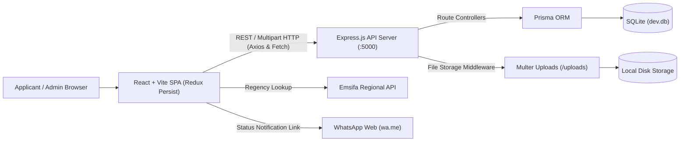
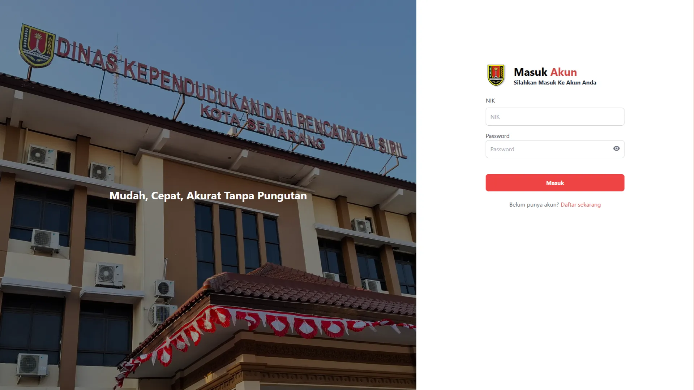
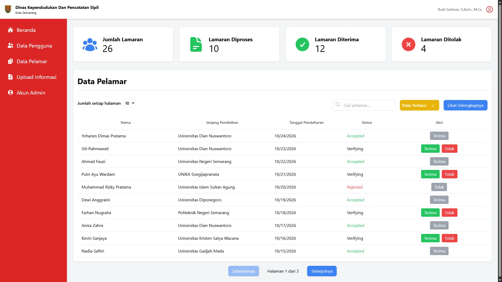
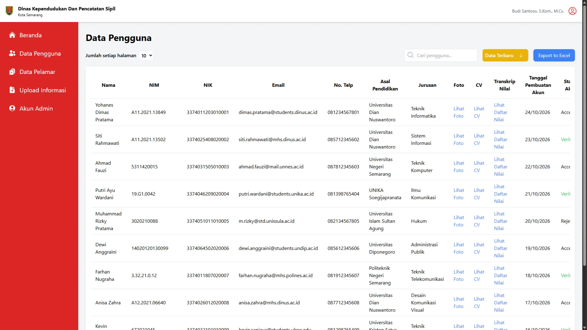
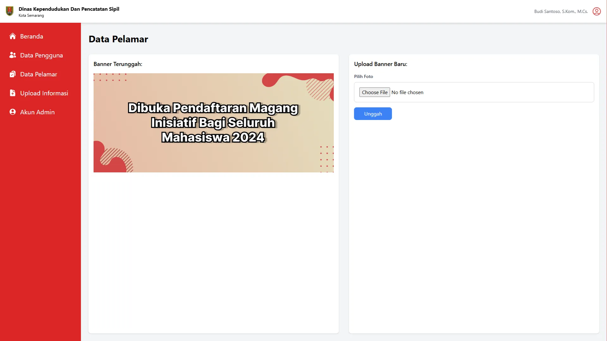
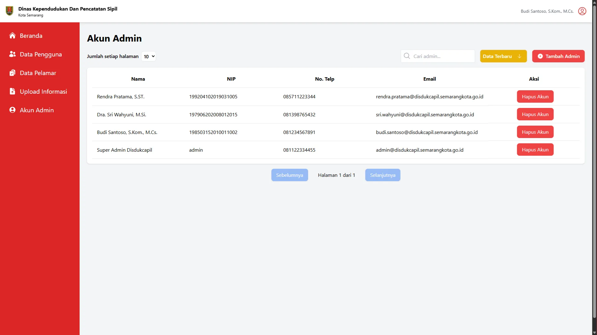

# Prajagamer - Internship Registration


## Project Overview

Prajagamer - Internship Registration is a full-stack web application built for the Department of Population and Civil Registration (Disdukcapil) of Semarang City to digitize and streamline university student internship applications. The platform replaces manual paper-based submissions with a structured online registration portal where students create NIK-indexed profiles, upload required PDF documents (CV, academic transcript, recommendation letter, and portfolio), and track application verification. On the administrative side, Disdukcapil staff manage incoming applications through a dedicated dashboard featuring real-time metrics, document previews, status updates with automated WhatsApp notifications, dynamic recruitment banner management, and one-click Excel reporting.

## Key Features

- **Public Information Portal**: Landing page, agency overview, partner university showcase, internship guidelines, terms and conditions, and live recruitment announcement banner.
- **NIK-Based Applicant Authentication & Registration**: Multi-field registration validating 16-digit NIK, password complexity, and multipart uploads for photo (JPG/PNG), CV (PDF), and academic transcript (PDF).
- **Two-Step Internship Application Flow**: Guided submission capturing branch placement willingness, internship start and end dates (minimum 30-day duration check), recommendation letter, CV, and optional portfolio PDFs.
- **Applicant Profile Management**: Editable personal, academic, supervisor, and KTP/domicile address profiles integrated with Indonesian regional province and regency lookup.
- **Admin Overview Dashboard**: Live KPI cards summarizing total, verifying, accepted, and rejected applications alongside a searchable, sortable, and paginated applicant table.
- **Document Inspection & Verification**: Direct browser previews for uploaded applicant photos, CVs, transcripts, recommendation letters, and portfolios with fallback asset handling.
- **Automated WhatsApp Status Notification**: Triggered `wa.me` deep-link notifications informing applicants immediately when admins accept or reject accounts or internship applications.
- **Excel Report Export**: Client-side spreadsheet generation (`Data_Pelamar_Magang.xlsx` and `Data_Pengguna_Magang.xlsx`) using SheetJS (`xlsx`) for administrative reporting.
- **Dynamic Recruitment Banner & Admin Management**: Admin controls to upload and publish updated recruitment banners as well as create, search, and remove staff administrator accounts.

## Tech Stack

| Category | Technology | Purpose |
| :--- | :--- | :--- |
| Frontend Framework | React | Component-based single-page user and admin interfaces |
| Build Tool | Vite | Fast development server and optimized production bundling |
| Styling | Tailwind CSS | Utility-first responsive UI styling across portal and admin views |
| Routing | React Router DOM | Client-side navigation across public, applicant, and admin routes |
| State Management | Redux Toolkit & Redux Persist | Centralized authentication, profile, and application state persistence |
| HTTP Client | Axios & Fetch API | REST API communication and multipart form submissions |
| UI Utilities | Heroicons, React Toastify, Swiper, React Slick | Vector icons, toast notifications, and informational carousels |
| Spreadsheet Export | SheetJS (`xlsx`) | Exporting user and applicant tables to `.xlsx` spreadsheets |
| Backend Runtime | Node.js | Server-side JavaScript execution environment |
| Backend Framework | Express.js | REST API routing, CORS, JSON parsing, and static file serving |
| File Upload Middleware | Multer | Handling multipart PDF and image uploads to `backend/uploads/` |
| ORM & Database | Prisma ORM & SQLite | Type-safe relational schema mapping and embedded `dev.db` persistence |
| Process Runner | Concurrently & Custom `runner.js` | Automated DB initialization, seeding, and concurrent dev orchestration |

## Application Architecture

The application follows a decoupled client-server architecture orchestrated locally by `runner.js`. The React + Vite frontend manages user and admin state via Redux Toolkit (persisted in browser storage) and communicates over HTTP/REST with the Express.js backend on port `5000`. Multer intercepts multipart file uploads (`photo`, `cv`, `score_list`, `recommend_letter`, `portofolio`, `banner`) into `backend/uploads/`, while Prisma ORM executes relational queries against the SQLite `dev.db` database. Additionally, the frontend integrates with the external Emsifa Indonesian Regional API for province/city selection and opens WhatsApp (`wa.me`) links for applicant status notifications.



## Screenshots / Preview

### 1. Applicant Login Portal

Split-screen applicant authentication page featuring a photograph of the Disdukcapil Kota Semarang office on the left and a clean NIK-and-password login form on the right with password visibility toggle and registration link.

### 2. Applicant Registration & Profile Overview

Side-by-side view of the two-column applicant registration screen (capturing NIK, NIM, academic details, and photo/CV/transcript uploads) alongside the authenticated applicant profile page displaying personal, educational, and supervisor details with an embedded office map.

### 3. Admin Dashboard & KPI Overview

Main administrative workspace summarizing total, processing, accepted, and rejected internship applications in four top KPI cards, paired with a searchable, sortable, and paginated table supporting direct Accept (*Terima*) and Reject (*Tolak*) actions.

### 4. User Management & Document Verification

Administrative directory of registered student accounts displaying NIM, NIK, contact details, university, major, direct links to view uploaded photos, CVs, and transcripts, account status indicators, and an *Export to Excel* button.

### 5. Full Applicant Records & Excel Export

Expanded applicant review table presenting placement willingness status alongside downloadable recommendation letters, CVs, portfolios, internship period dates, and one-click `.xlsx` spreadsheet export.

### 6. Recruitment Banner Management

Content management view allowing administrators to inspect the currently active internship announcement banner on the left and upload a replacement JPG or PNG banner image on the right.

### 7. Administrator Account Management

Staff management console listing registered administrator accounts by name, NIP, phone number, and email, complete with search, sorting, pagination, account deletion controls, and a modal workflow for adding new admins.

## Prerequisites

- Node.js (v18.0.0 or higher recommended)
- npm (v9.0.0 or higher)
- Git

## Installation & Setup

1. Clone the repository to your local machine:

```bash
git clone https://github.com/weztcy/Prajagamer-Internship-Registration.git
cd "Prajagamer - Internship Registration"
```

2. Install dependencies for the root workspace, backend, and frontend:

```bash
npm install
npm run install:all
```

3. Verify the environment configuration files in `backend/.env` and `frontend/.env` (see the **Environment Variables** section below).

4. Push the Prisma schema and populate the SQLite database with initial admin accounts, sample applicants, and placeholder documents (also runs automatically on first launch of `runner.js`):

```bash
npx prisma db push --schema="backend/prisma/schema.prisma"
npm run seed
```

## Usage

You can start both the Express.js backend and React Vite frontend simultaneously using the root runner script, or run each service individually.

1. Launch the full-stack application from the repository root:

```bash
npm run dev
```

2. Open the application in your browser:
   - **Public Portal & Applicant Login**: `http://localhost:5173` (Applicant login at `/login`)
   - **Admin Portal Login**: `http://localhost:5173/loginadmin`
   - **Backend REST API**: `http://localhost:5000`

3. Optionally run backend and frontend servers in separate terminals:

```bash
npm run dev:backend
npm run dev:frontend
```

> Demo applicant (NIK) and administrator (NIP) credentials for local testing are printed directly in the terminal console when running `npm run dev` via `runner.js`.

## Environment Variables

Both the backend and frontend read runtime configuration from `.env` files located in their respective directories.

| Variable | Description | Example |
| :--- | :--- | :--- |
| `PORT` | Port number for the Express.js backend server | `5000` |
| `DATABASE_URL` | SQLite file path used by Prisma ORM | `file:./dev.db` |
| `VITE_API_BASE_URL` | Base URL of the backend API consumed by the React frontend | `http://localhost:5000` |

`backend/.env`:

```env
PORT=5000
DATABASE_URL="file:./dev.db"
```

`frontend/.env`:

```env
VITE_API_BASE_URL=http://localhost:5000
```

## API Documentation

The backend exposes REST endpoints under `/api` for authentication, applicant profile management, internship applications, admin operations, and recruitment banner updates, as well as `/uploads` for serving stored media and PDF documents.

| Method | Endpoint | Description | Authentication |
| :--- | :--- | :--- | :--- |
| `POST` | `/api/user/register` | Register applicant account with photo, CV, and transcript | Public |
| `POST` | `/api/user/login` | Authenticate applicant using NIK and password | Public |
| `GET` | `/api/profile` | Retrieve authenticated applicant profile and university info | Bearer Token |
| `POST` | `/api/profile` | Update applicant personal, academic, supervisor, and photo data | Bearer Token |
| `GET` | `/api/internship-form` | Retrieve saved internship application record for user | Bearer Token |
| `POST` | `/api/apply-internship` | Submit placement willingness, period dates, and PDF documents | Bearer Token |
| `POST` | `/api/admin/login` | Authenticate administrator using NIP and password | Public |
| `GET` | `/api/admin/dashboard` | Retrieve KPI counts and applicant list for admin dashboard | Admin Session |
| `GET` | `/api/users` | Fetch all registered users with profile and academic relations | Admin Session |
| `GET` | `/api/users2` | Fetch all internship applicants for review and Excel export | Admin Session |
| `PUT` | `/api/users/status` | Update user verification status | Admin Session |
| `PUT` | `/api/users/status2` | Update internship application status (`Accepted` / `Rejected`) | Admin Session |
| `GET` | `/api/admins` | List all administrators or query a specific admin by NIP | Admin Session |
| `POST` | `/api/admin/register` | Create a new administrator account | Admin Session |
| `DELETE` | `/api/admin/:id` | Delete an administrator account by ID | Admin Session |
| `GET` | `/api/banner` | Retrieve active recruitment banner image (`?nameBanner=Lowongan`) | Public |
| `PUT` / `POST` | `/api/banner` | Upload or replace the recruitment banner image | Admin Session |

Representative login request and response:

```json
// POST /api/user/login
{
  "nik": "3374011203010001",
  "password": "your-password"
}
```

```json
{
  "message": "Login Berhasil",
  "token": "user-token-1-1732470000000",
  "user": {
    "id": 1,
    "name": "Yohanes Dimas Pratama",
    "email": "dimas.pratama@students.dinus.ac.id",
    "nik": "3374011203010001",
    "status": "Accepted"
  }
}
```

## API Integration

In addition to its internal Express.js REST API, the React frontend connects to external web services for regional address selection and applicant communication.

| API / Service | Purpose | Usage |
| :--- | :--- | :--- |
| Emsifa Indonesian Wilayah API | Fetch regency/city lists based on selected province ID | Consumed via Axios in `EditProfile.jsx` for KTP and domicile address fields |
| WhatsApp Web (`wa.me`) | Send acceptance or rejection notifications to applicant phone numbers | Triggered in a new browser tab from admin tables upon status updates |

## Database Configuration

Persistence is managed by Prisma ORM backed by an embedded SQLite database (`backend/prisma/dev.db`), eliminating external database server setup for local runs. A reference MySQL DDL (`frontend/db_prajagamer.sql`) is also preserved in the repository.

1. Inspect or modify the relational schema in `backend/prisma/schema.prisma` (`User`, `Profile`, `University`, `Regist`, `Admin`, and `Banner` models).
2. Synchronize the schema with SQLite:

```bash
npx prisma db push --schema="backend/prisma/schema.prisma"
```

3. Seed initial administrator accounts, 26 sample applicants, placeholder PDF documents, and default banner assets:

```bash
npm run seed
```

## Authentication & Authorization

The application separates public applicant flows and internal administrative operations through distinct credential identifiers and client-side route guards.

- **Dual Credential Flows**: Applicants authenticate using their 16-digit National Identity Number (`nik`) at `/login`, while Disdukcapil staff authenticate using their Employee Identification Number (`nip`) at `/loginadmin`.
- **Client State & Token Storage**: Applicant tokens are stored in Redux (`state.auth.token`) and persisted via `redux-persist`, whereas administrator sessions store tokens in `localStorage` and redirect unauthenticated requests back to `/loginadmin`.
- **Backend Token Handling**: Successful logins issue structured session tokens (`user-token-<id>-<timestamp>` and `admin-token-<id>-<timestamp>`), with `/api/profile`, `/api/internship-form`, and `/api/apply-internship` parsing the user ID from the `Authorization: Bearer` header. (Note: Current backend handlers are configured for local evaluation and demo workflows without cryptographic JWT signature verification.)

## Build & Deployment

The frontend is configured for static single-page application hosting (including `frontend/vercel.json` SPA URL rewrites), while the backend runs as a standard Node.js/Express service.

1. Generate the optimized production bundle for the React frontend into `frontend/dist/`:

```bash
npm run build
```

2. Preview the built frontend locally:

```bash
npm run preview --prefix frontend
```

3. Start the Express.js backend in production mode (ensure `VITE_API_BASE_URL` points to the deployed backend URL before building the frontend):

```bash
npm start --prefix backend
```

## Contributing

Contributions, bug reports, and feature enhancements are welcome. Please follow these steps to contribute:

1. Fork the repository.
2. Create a feature branch for your change (`git checkout -b feature/your-feature`).
3. Make and test your changes locally across both frontend and backend.
4. Commit and push the branch to your fork.
5. Open a pull request with a clear explanation of your changes.

## License

This project is licensed under the MIT License.
See the [LICENSE](LICENSE) file for details.

## Author & Contact

**Yohanes Dimas Pratama**

- GitHub: [github.com/weztcy](https://github.com/weztcy)
- Portfolio: [yohanesdimas.com](https://yohanesdimas.com)
- LinkedIn: [linkedin.com/in/yohanes-dimas](https://www.linkedin.com/in/yohanes-dimas)
