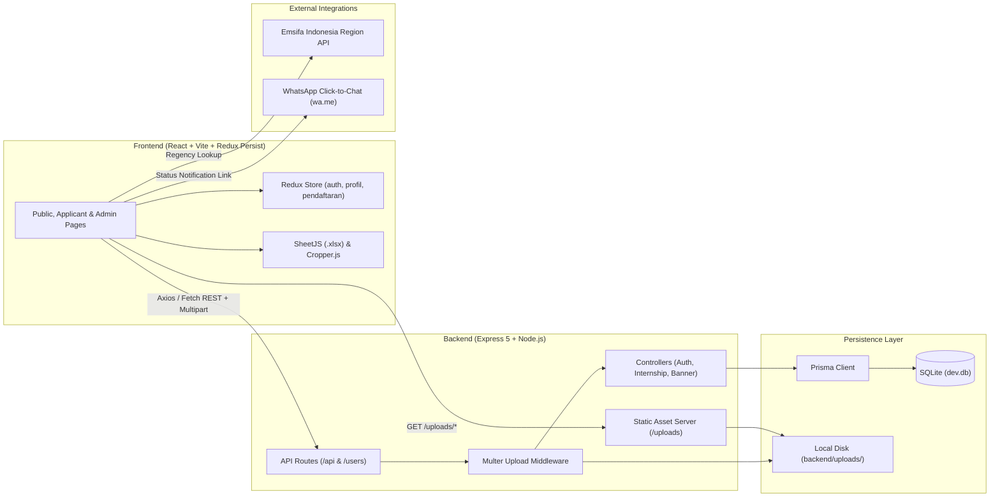
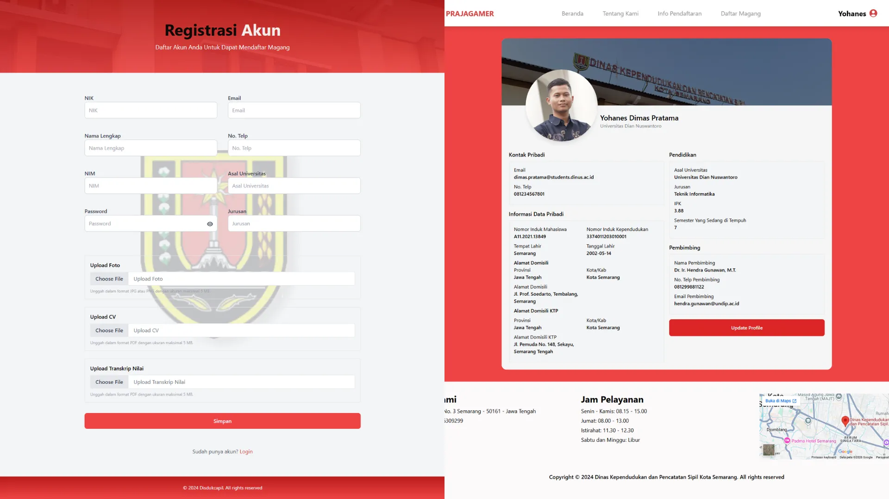
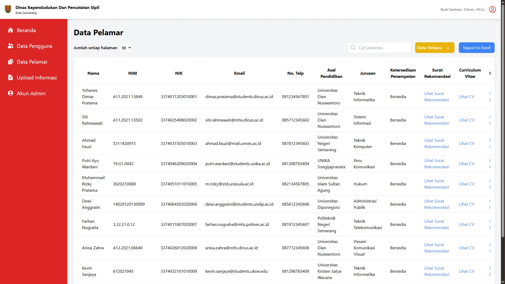

# Prajagamer - Internship Registration


## Project Overview

Prajagamer - Internship Registration is a full-stack web application built for the Department of Population and Civil Registration (Disdukcapil) of Semarang City to digitize student internship applications and administrative review workflows. It provides a public informational portal, a multi-step applicant registration and document submission system, and an administrative dashboard for verifying candidates, managing recruitment announcements, and exporting records.

## Key Features

- Public informational portal detailing Disdukcapil Semarang organizational divisions, partner service units, registration requirements, and live recruitment banners.
- Applicant account registration with NIK-based login, multipart upload for profile photos, CVs, and academic transcripts, and an interactive profile editor with image cropping and regional address selection.
- Two-stage internship application workflow capturing placement availability, internship start and end dates (enforcing a minimum 30-day duration), recommendation letters, CVs, and optional portfolios.
- Administrative dashboard displaying real-time applicant status metrics (`Total`, `Verifying`, `Accepted`, `Rejected`) alongside search, sorting, and pagination controls.
- Applicant and user management tables supporting one-click status updates (`Accepted` / `Rejected`), document previews, WhatsApp notification links, and `.xlsx` spreadsheet exports.
- Dynamic recruitment banner management (`Lowongan`) and administrator account CRUD operations (`GET`, `POST`, `DELETE`) protected by token checks.

## Tech Stack

| Category | Technology | Purpose |
| :--- | :--- | :--- |
| Frontend Framework | React | Component-based single-page user and admin interfaces |
| Build Tool | Vite | Fast development server and production asset bundling |
| Styling | Tailwind CSS | Utility-first responsive layout and UI styling |
| State Management | Redux Toolkit & Redux Persist | Centralized auth, profile, and registration state persisted to browser storage |
| Routing | React Router | Client-side navigation across public, applicant, and admin routes |
| HTTP Client | Axios & Fetch API | REST communication and multipart form uploads to the backend API |
| UI Enhancements | Heroicons, React Toastify, React Slick, Swiper, Cropper.js | Icons, toast notifications, partner carousels, and profile image cropping |
| Spreadsheet Export | SheetJS (`xlsx`) | Client-side export of applicant and user tables into `.xlsx` files |
| Backend Framework | Express | RESTful API routing, static file serving, and request handling |
| ORM & Database | Prisma & SQLite | Type-safe relational schema modeling and local `dev.db` persistence |
| File Upload Middleware | Multer | Disk storage handling for applicant documents, photos, and banners |
| Process Orchestration | Node.js & Concurrently | Unified database initialization, seeding, and dual-server startup via `runner.js` |

## Application Architecture

The application follows a decoupled client-server architecture orchestrated locally by `runner.js`. The React single-page frontend manages authentication, applicant profiles, and multi-step internship forms through Redux Toolkit and Redux Persist, communicating over HTTP with the Express backend. The Express server routes requests through dedicated controllers (`authController`, `internshipController`, `bannerController`, `userController`), persists relational records in SQLite via Prisma ORM, stores uploaded PDFs and images on disk under `backend/uploads/`, and integrates with external regional lookup and WhatsApp messaging links on the client.



## Screenshots / Preview

### 1. Applicant Login Portal

Split-screen applicant authentication page pairing a Disdukcapil Kota Semarang visual panel with a NIK and password login form, password visibility toggle, and account registration shortcut.

### 2. Account Registration & Applicant Profile

Composite view of the applicant registration workflow—capturing NIK, NIM, university, major, and required PDF/image uploads—alongside the applicant profile dashboard displaying personal details, GPA, semester, and academic supervisor records.

### 3. Admin Dashboard Overview

Administrative control center summarizing total applications, pending verifications, accepted candidates, and rejected submissions above a searchable, sortable, and paginated applicant review table.

### 4. Registered Users Directory

User management view displaying registered student accounts with NIM, NIK, institutional metadata, direct links to uploaded photos, CVs, and transcripts, search/sorting filters, and Excel export.

### 5. Internship Applicants & Document Review

Applicant verification table showing placement availability, recommendation letters, CVs, portfolios, and internship periods with pagination, sorting, and one-click `.xlsx` export.

### 6. Recruitment Banner Management

Administrative content panel displaying the active recruitment announcement banner alongside an image uploader (`JPG`/`PNG`) to update the public registration notice dynamically.

### 7. Administrator Account Management

Role management interface listing authorized Disdukcapil staff accounts by name, NIP, phone number, and email, complete with search, sorting, modal-based admin creation, and deletion controls.

## Prerequisites

- **Node.js** (v18.x or higher recommended)
- **npm** (v9.x or higher)

## Installation & Setup

1. Clone the repository and navigate to the project root:

```bash
git clone https://github.com/weztcy/Prajagamer-Internship-Registration.git
cd "Prajagamer - Internship Registration"
```

2. Install root, backend, and frontend dependencies:

```bash
npm install
npm run install:all
```

3. Configure environment files in `backend/.env` and `frontend/.env` (see **Environment Variables** below).

4. Push the Prisma schema to SQLite and seed initial demo accounts and sample documents:

```bash
npx --prefix backend prisma db push --schema=backend/prisma/schema.prisma
npm run seed
```

## Usage

You can start both the Express backend and Vite frontend simultaneously using the unified runner script, which also initializes and seeds the SQLite database automatically if `backend/prisma/dev.db` is missing.

1. Start the full-stack development environment from the repository root:

```bash
npm run dev
```

2. Access the applications in your browser:
   - **Frontend Portal**: `http://localhost:5173`
   - **Applicant Login**: `http://localhost:5173/login`
   - **Admin Portal Login**: `http://localhost:5173/loginadmin`
   - **Backend API**: `http://localhost:5000`

3. Alternatively, run each service independently:

```bash
npm run dev:backend
npm run dev:frontend
```

## Environment Variables

Environment configuration files specify the backend server port, Prisma SQLite connection string, and frontend API base URL.

| Variable | Description | Example |
| :--- | :--- | :--- |
| `PORT` | Port number for the Express backend server | `5000` |
| `DATABASE_URL` | Prisma datasource connection URL for SQLite | `"file:./dev.db"` |
| `VITE_API_BASE_URL` | Base URL used by the Vite frontend to call backend APIs | `http://localhost:5000` |

`backend/.env`:

```env
PORT=5000
DATABASE_URL="file:./dev.db"
```

`frontend/.env`:

```env
VITE_API_BASE_URL=http://localhost:5000
```

## API Documentation

The Express server exposes REST endpoints under `/api` (plus legacy `/users` routes) for authentication, profile management, internship submissions, admin analytics, and banner uploads.

| Method | Endpoint | Description | Authentication |
| :--- | :--- | :--- | :--- |
| `POST` | `/api/user/login` | Authenticate an applicant using NIK and password | Public |
| `POST` | `/api/user/register` | Register a new applicant with `photo`, `cv`, and `score_list` uploads | Public |
| `POST` | `/api/admin/login` | Authenticate an administrator using NIP and password | Public |
| `GET` | `/api/admins` | List all administrators or query by `nip` | Admin Token |
| `POST` | `/api/admin/register` | Create a new administrator account | Admin Token |
| `DELETE` | `/api/admin/:id` | Remove an administrator account by ID | Admin Token |
| `GET` | `/api/admin/dashboard` | Retrieve KPI totals and full applicant summary list | Admin Token |
| `GET` | `/api/users` | Fetch all registered users with profile, university, and registration data | Admin Token |
| `GET` | `/api/users2` | Fetch all internship applicants with document metadata | Admin Token |
| `PUT` | `/api/users/status` | Update an applicant's verification status (`Accepted`, `Rejected`, `Verifying`) | Admin Token |
| `GET` | `/api/profile` | Retrieve the authenticated applicant's profile details | Bearer Token |
| `POST` | `/api/profile` | Update applicant profile fields and optional profile `photo` | Bearer Token |
| `GET` | `/api/internship-form` | Retrieve saved internship registration details for the user | Bearer Token |
| `POST` | `/api/apply-internship` | Submit internship dates, placement willingness, and PDF attachments | Bearer Token |
| `GET` | `/api/banner` | Serve the recruitment banner image (`nameBanner=Lowongan`) | Public |
| `PUT` / `POST` | `/api/banner` | Upload and replace a recruitment banner image | Admin Token |

Example login response (`POST /api/user/login`):

```json
{
  "message": "Login Berhasil",
  "token": "user-token-1-1700000000000",
  "user": {
    "id": 1,
    "name": "Yohanes Dimas Pratama",
    "email": "dimas.pratama@students.dinus.ac.id",
    "nik": "3374011203010001",
    "status": "Accepted"
  }
}
```

## API Integration

In addition to its own Express REST API, the frontend consumes two external web interfaces to enhance applicant data entry and administrative communication.

| API / Service | Purpose | Usage |
| :--- | :--- | :--- |
| Emsifa Wilayah Indonesia API | Indonesian regency/city lookup by province | Queried via Axios in `EditProfile.jsx` (`https://www.emsifa.com/api-wilayah-indonesia/api/regencies/{provinceId}.json`) to populate KTP and domicile city dropdowns |
| WhatsApp Click-to-Chat (`wa.me`) | Applicant status notification shortcut | Opened in a new tab from `DataPengguna.jsx` and `DataPelamar.jsx` with pre-filled acceptance or rejection messages formatted for Indonesian phone numbers (`62...`) |

## Database Configuration

The active backend uses SQLite managed by Prisma ORM (`backend/prisma/schema.prisma`), defining six relational models: `User`, `Profile`, `University`, `Regist`, `Admin`, and `Banner` (with a legacy MySQL reference script retained in `frontend/db_prajagamer.sql`).

1. Ensure `DATABASE_URL="file:./dev.db"` is set in `backend/.env`.
2. Synchronize the Prisma schema with the local SQLite database:

```bash
npx --prefix backend prisma db push --schema=backend/prisma/schema.prisma
```

3. Populate the database with 4 administrator accounts, 26 sample applicants, sample PDFs, and the default recruitment banner:

```bash
npm run seed
```

## Authentication & Authorization

The application separates applicant and administrator workflows using distinct credentials and token prefixes issued upon login and checked across client routes.

- **Applicant Authentication**: Applicants log in with their 16-digit National Identity Number (`nik`) and password via `/api/user/login`, receiving a `user-token-<id>-<timestamp>` token persisted in Redux (`redux-persist`) to authorize profile and internship application requests.
- **Administrator Authentication**: Staff members log in with their Civil Servant Identification Number (`nip`) and password via `/api/admin/login`, receiving an `admin-token-<id>-<timestamp>` stored in `localStorage` and verified by admin pages (`/admin`, `/datapelamar`, `/datapengguna`, `/updateinfo`, `/adminakun`) before loading data.
- **Route Guards**: Protected applicant routes (`/formpendaftaran1`, `/formpendaftaran2`, `/editprofile`) redirect unauthenticated visitors to `/login` or `/loginopsi`, while admin routes redirect missing tokens to `/loginadmin`.

## Build & Deployment

The frontend is configured for static single-page application hosting (including SPA fallback rewrites in `frontend/vercel.json`), while the backend runs as a Node.js Express service.

1. Build the production frontend bundle into `frontend/dist/`:

```bash
npm run build
```

2. Preview the compiled frontend bundle locally if needed:

```bash
npm run preview --prefix frontend
```

3. Deploy `frontend/dist/` (with `frontend/vercel.json` handling client-side route rewrites to `/index.html`) and point `VITE_API_BASE_URL` to your hosted Express backend instance.

## Contributing

Contributions are welcome to improve functionality, accessibility, or documentation.

1. Fork the repository.
2. Create a feature branch (`git checkout -b feature/your-feature`).
3. Make and verify your changes locally.
4. Commit and push your branch (`git push origin feature/your-feature`).
5. Open a pull request with a clear description of the updates.

## License

This project is licensed under the MIT License.
See the [LICENSE](LICENSE) file for details.

## Author & Contact

**Yohanes Dimas Pratama**

- GitHub: [github.com/weztcy](https://github.com/weztcy)
- Portfolio: [yohanesdimas.com](https://yohanesdimas.com)
- LinkedIn: [linkedin.com/in/yohanes-dimas](https://www.linkedin.com/in/yohanes-dimas)
